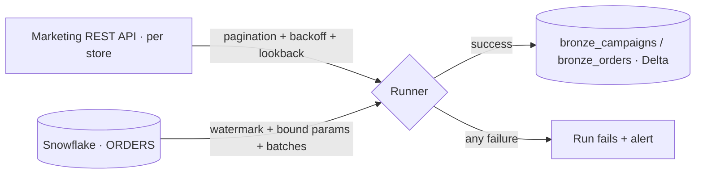

# 🔌 REST APIs + Snowflake → Microsoft Fabric Bronze | No silent failures


**Fabric simulation** for a fictional omnichannel retailer, *Andes Retail*. Campaign data comes from a paginated, rate-limited **REST API** per store, and orders come incrementally from **Snowflake**. Everything lands as raw **Delta** in a **Fabric Lakehouse**, and one broken source turns the run red instead of hiding.



## Stack
`REST APIs` · `Snowflake` · `Microsoft Fabric` (Lakehouse, Notebooks, Data Pipelines) · `PySpark` · `Delta Lake` · `Azure Key Vault` · `pytest` · `GitHub Actions`

## What it handles
- **Rate limits:** honours `Retry-After` on 429, exponential backoff on 5xx, hard cap on retries
- **Fail fast on client errors:** a 401 is not retried, it is reported
- **Pagination:** follows `next` links until the last page
- **Late-arriving data:** re-reads a lookback window, because ad platforms restate recent days
- **Snowflake incremental:** watermark query with bound parameters (no SQL injection) streamed in batches, not loaded all at once
- **No silent gaps:** one failing store never blocks the others, but the run still ends red with the failed sources listed
- **Secrets:** API token and Snowflake credentials come from Azure Key Vault at runtime

## Run the tests
```bash
pip install -e ".[dev]"
pytest
```

## Run it in Fabric
1. Store the API token and Snowflake credentials in Key Vault
2. Install the package in a Fabric Environment (`pip install "sourcehub[snowflake] @ git+https://github.com/lucas-wall/api-snowflake-to-fabric"`)
3. Schedule `notebooks/01_bronze_sources.py` from a Fabric Data Pipeline

> Sample data, company names and endpoints are fictional.
